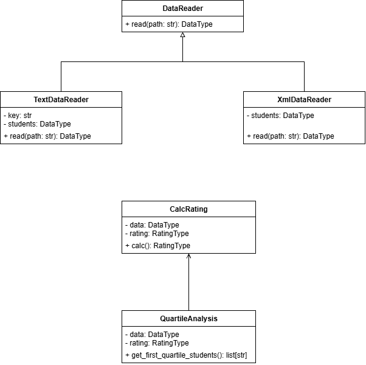

# Лабораторная 1 по дисциплине "Технологии программирования"

## Цели

1. Познакомиться с распределенной системой контроля версий кода Git и ее функциями.
2. Познакомиться с понятиями «непрерывная интеграция» (CI) и «непрерывное развертывание» (CD), определить их место в современной разработке программного обеспечения.
3. Получить навыки разработки ООП-программ и написания модульных тестов к ним на современных языках программирования.
4. Получить навыки работы с системой Git для хранения и управления версиями ПО.
5. Получить навыки управления автоматизированным тестированием программного обеспечения, расположенного в системе Git, с помощью инструмента GitHub Actions.

# Порядок работы

## Основная часть:
- Создан проект на Python 3, рассчитывающий средний рейтинг студентов из ".txt" файла.
- Реализованы классы "DataReader" (абстрактный), "TextDataReader" и "CalcRating".
- Написаны модульные тесты (pytest) для всех классов.
- Настроен GitHub Actions для автоматической проверки стиля (pycodestyle) и запуска тестов при пуше.

## Индивидуальное задание (Вариант 5):
- Добавлены файлы "LICENSE" (MIT) и ".gitignore".
- Создана ветка "individ": разработаны классы "XmlDataReader", "QuartileAnalysis"  и тесты к нbv.
- Обе ветки слиты в "main" после успешного прохождения тестов.
- Составлена UML-диаграмма классов.

## Результаты

1. Репозиторий GitHub: Весь проект хранится в Git и отправлен в удаленный репозиторий.
2. CI/CD: Настроен workflow GitHub Actions. При каждом пуше в `main` запускается проверка стиля кода и модульные тесты.
3. Тесты: Все модульные тесты (включая тесты для `XmlDataReader` и `QuartileAnalysis`) успешно проходят. Статус сборки в GitHub Actions — зеленый.

## Выводы

В ходе выполнения лабораторной работы были достигнуты все поставленные цели:
- Освоены основные команды Git (создание веток, коммиты, слияние).
- Закреплены навыки ООП-разработки на Python 3.
- Получен опыт написания модульных тестов с использованием `pytest`.
- Изучен принцип работы непрерывной интеграции (CI) на примере GitHub Actions.
- В рамках индивидуального задания реализован парсинг XML-файлов и применен статистический метод (расчет квартилей).
